# DOSSIER TECHNIQUE DE PRÉSENTATION DES INTERFACES — FRIGOMALIN
### Atelier de Développement Mobile — Master 2 Génie Logiciel

**Étudiante :** Diom Lucraine Lethicia Fien  
**Filière :** Master 2 en Génie Logiciel (Niveau 5)  
**Projet :** FrigoMalin — Application Mobile Intelligente Anti-Gaspillage Alimentaire  
**Plateforme & Framework :** .NET MAUI (.NET 10) — C# / XAML  
**Architecture logicielle :** MVVM (Model-View-ViewModel) & Persistance SQLite  
**Nombre d'interfaces réalisées :** 11 interfaces fonctionnelles  

---

## Sommaire du Dossier

1. [Introduction & Contexte du Projet](#1-introduction--contexte-du-projet)
2. [Architecture Technique & Choix Pédagogiques](#2-architecture-technique--choix-pédagogiques)
3. [Répertoire Détaillé des 11 Interfaces Mobiles](#3-répertoire-détaillé-des-11-interfaces-mobiles)
   - [Interface 1 : Page de Connexion (`LoginPage`)](#interface-1--page-de-connexion-loginpage)
   - [Interface 2 : Page d'Inscription (`RegisterPage`)](#interface-2--page-dinscription-registerpage)
   - [Interface 3 : Inventaire « Mon Frigo » & Alertes d'Urgence (`FridgePage`)](#interface-3--inventaire-mon-frigo--alertes-durgence-fridgepage)
   - [Interface 4 : Fiche Détaillée d'un Aliment (`FoodDetailPage`)](#interface-4--fiche-détaillée-dun-aliment-fooddetailpage)
   - [Interface 5 : Formulaire d'Ajout d'Aliment (`AddEditFoodPage`)](#interface-5--formulaire-dajout-daliment-addeditfoodpage)
   - [Interface 6 : Checklist Interactive de Marché (`ShoppingListPage`)](#interface-6--checklist-interactive-de-marché-shoppinglistpage)
   - [Interface 7 : Modale de Transfert Marché vers Frigo (`TransferConfirmModal`)](#interface-7--modale-de-transfert-marché-vers-frigo)
   - [Interface 8 : Menus de la Semaine & Idées Recettes Anti-Gaspi (`RecipesPage`)](#interface-8--menus-de-la-semaine--idées-recettes-anti-gaspi-recipespage)
   - [Interface 9 : Fiche Complète d'une Recette (`RecipeDetailPage`)](#interface-9--fiche-complète-dune-recette-recipedetailpage)
   - [Interface 10 : Bilan Anti-Gaspi & Analytics Financiers (`WasteStatsPage`)](#interface-10--bilan-anti-gaspi--analytics-financiers-wastestatspage)
   - [Interface 11 : Profil Utilisateur & Paramètres (`ProfileSettingsPage`)](#interface-11--profil-utilisateur--paramètres-profilesettingspage)
4. [Guide d'Exportation du Dossier au Format PDF](#4-guide-dexportation-du-dossier-au-format-pdf)

---

## 1. Introduction & Contexte du Projet

Le gaspillage alimentaire dans les foyers découle principalement de l'oubli des denrées stockées dans le réfrigérateur et d'une mauvaise anticipation lors des achats. L'application mobile **FrigoMalin** propose une réponse méthodique à travers un cycle vertueux complet :

1. **Recensement et anticipation :** Classement des denrées selon leur date de péremption avec mise en évidence des produits à consommer en priorité.
2. **Gestion des courses synchronisée :** Une checklist interactive qui convertit directement les produits achetés au marché en stocks dans le frigo avec enregistrement de leur date limite.
3. **Valorisation culinaire :** Un générateur de suggestions de recettes optimisé pour utiliser en premier lieu les ingrédients en situation d'urgence.
4. **Mesure de l'impact écologique et financier :** Un tableau de bord chiffrant les économies réalisées en Francs CFA et le taux d'aliments préservés.

---

## 2. Architecture Technique & Choix Pédagogiques

L'application a été conçue dans le respect des standards industriels et des patrons de conception recommandés pour les applications d'entreprise :

- **Patron MVVM (Model-View-ViewModel) :** Utilisation de `CommunityToolkit.Mvvm` pour automatiser la notification de propriétés (`[ObservableProperty]`) et la gestion des commandes asynchrones (`[RelayCommand]`).
- **Inversion de Contrôle (IoC) & Injection de Dépendances (DI) :** Déclaration de l'ensemble des services métiers (`IFoodService`, `IShoppingService`, `IRecipeService`, `IWasteService`, `IAuthService`, `IDatabaseService`) et de leurs ViewModels dans `MauiProgram.cs`.
- **Navigation Déclarative MAUI Shell :** Définition de la barre d'onglets principale (`TabBar`) et enregistrement des routes secondaires (`FoodDetailPage`, `RecipeDetailPage`, `AddEditFoodPage`, `RegisterPage`) via `Routing.RegisterRoute`.
- **Persistance Locale SQLite :** Base de données relationnelle locale (`sqlite-net-pcl`) assurant le fonctionnement hors-ligne de l'application.
- **Ressources Vectorielles :** Remplacement de tout élément emoji par des icônes vectorielles SVG natives compilées automatiquement par MAUI dans `Resources/Images/`.

---

## 3. Répertoire Détaillé des 11 Interfaces Mobiles

---

### Interface 1 : Page de Connexion (`LoginPage`)

#### Rôle & Spécifications Fonctionnelles :
- Point d'entrée de l'application permettant l'authentification sécurisée de l'utilisateur.
- Saisie de l'adresse email et du mot de passe avec masquage automatique des caractères.
- Option « Se souvenir de moi » persistée dans les préférences locales.
- **Bouton « Connexion Démo Rapide » :** Permet une évaluation immédiate en initialisant une session de démonstration avec un jeu de données complet.
- Lien d'accès vers la page de création de compte (`RegisterPage`).

  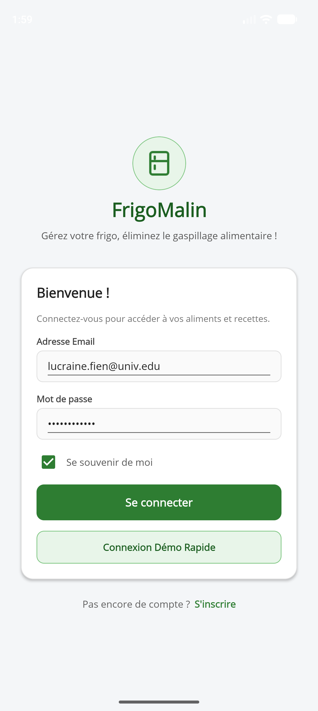

#### Composants XAML & Implémentation MVVM :
- **Fichier Source :** `Views/LoginPage.xaml` et `ViewModels/LoginViewModel.cs`
- **Contrôles utilisés :** `Entry` avec `IsPassword="True"`, `CheckBox`, `Button` avec styles personnalisés (`BackgroundColor`, `CornerRadius="10"`), conteneur `Frame` avec ombre portée (`HasShadow="True"`).
- **Navigation :** `Shell.Current.GoToAsync("//MainTabs/FridgePage")` lors de la validation.

---

### Interface 2 : Page d'Inscription (`RegisterPage`)

#### Rôle & Spécifications Fonctionnelles :
- Formulaire de création de compte permettant de paramétrer le profil du foyer.
- Saisie du nom complet, de l'adresse email, du mot de passe et de la taille du foyer (nombre de personnes).
- Adaptation automatique des portions pour les recettes de cuisine selon le nombre de personnes renseigné.
- Bouton de retour direct vers l'écran d'authentification.

  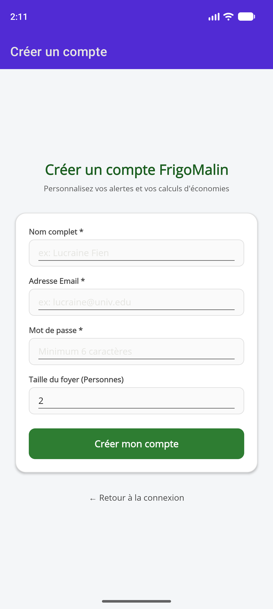

#### Composants XAML & Implémentation MVVM :
- **Fichier Source :** `Views/RegisterPage.xaml` et `ViewModels/RegisterViewModel.cs`
- **Contrôles utilisés :** `VerticalStackLayout`, `Entry` de type numérique (`Keyboard="Numeric"`), validation des champs requis par `RegisterCommand`.
- **Navigation :** Redirection vers `LoginPage` via `Shell.Current.GoToAsync("//LoginPage")`.

---

### Interface 3 : Inventaire « Mon Frigo » & Alertes d'Urgence (`FridgePage`)

#### Rôle & Spécifications Fonctionnelles :
- Tableau de bord principal présentant la totalité des aliments en stock dans le réfrigérateur.
- **Bannière d'alerte dynamique rouge :** Apparaît automatiquement dès que des aliments ont une date limite critique (inférieure ou égale à 2 jours).
- **Classification par niveau d'urgence :**
  - **Urgent (fond rouge léger / bordure rouge) :** Aliments à consommer le jour même ou le lendemain.
  - **À consommer (fond orange léger) :** Aliments dont l'échéance est comprise entre 3 et 5 jours.
  - **Bon état (fond vert léger) :** Aliments disposant d'un délai supérieur à 5 jours.
- **Barre de recherche textuelle :** Filtrage en direct de la liste par nom d'aliment.
- **Actions rapides :** Boutons « Consommé (Sauvé) » pour alimenter les statistiques positives, et « Jeté (Périmé) » pour tracer les pertes.

  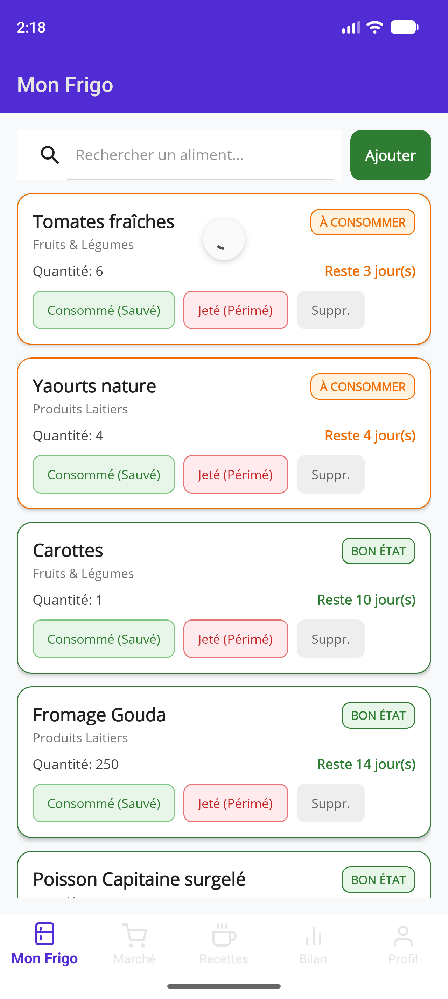

#### Composants XAML & Implémentation MVVM :
- **Fichier Source :** `Views/FridgePage.xaml` et `ViewModels/FridgeViewModel.cs`
- **Contrôles utilisés :** `SearchBar` lié à `SearchText` et `SearchCommand`, `CollectionView` avec `ItemTemplate`, cartes `Border` stylisées, icône SVG d'alerte dans la bannière supérieure.
- **Navigation :** Sélection d'un élément redirigeant vers `FoodDetailPage` avec passage de paramètres.

---

### Interface 4 : Fiche Détaillée d'un Aliment (`FoodDetailPage`)

#### Rôle & Spécifications Fonctionnelles :
- Consultation approfondie des paramètres d'un aliment sélectionné dans l'inventaire.
- Décompte précis du nombre de jours restants avant la date limite de péremption.
- **Conseils ergonomiques d'emplacement dans le réfrigérateur :** Indication de la zone de froid optimale recommandée pour maximiser la fraîcheur (ex. : *Zone très froide de 0°C à 2°C sur la clayette inférieure pour les viandes*, *Bac à légumes à humidité contrôlée pour les crudités*).
- Clôture du cycle de vie de l'aliment (Marquer comme consommé ou jeté).

  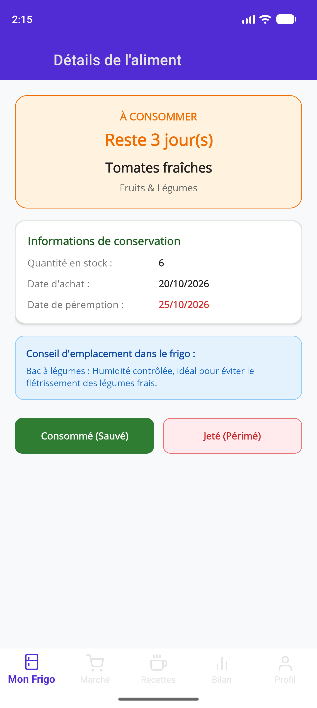

#### Composants XAML & Implémentation MVVM :
- **Fichier Source :** `Views/FoodDetailPage.xaml` et `ViewModels/FoodDetailViewModel.cs`
- **Contrôles utilisés :** `QueryProperty` pour la réception de l'objet `FoodItem`, `Label` avec formatage de texte, cartes informatives à angles arrondis.

---

### Interface 5 : Formulaire d'Ajout d'Aliment (`AddEditFoodPage`)

#### Rôle & Spécifications Fonctionnelles :
- Saisie manuelle directe d'une nouvelle denrée dans le stock du réfrigérateur.
- Renseignement du nom de l'aliment, de la catégorie (Fruits et Légumes, Produits Laitiers, Viandes et Poissons, Boissons, Épicerie), de la quantité et de l'unité de mesure.
- Coût unitaire estimé (permettant le calcul ultérieur des économies ou du gaspillage en FCFA).
- **Sélection de la date limite :** Utilisation d'un sélecteur de calendrier (`DatePicker`) pour calquer l'échéance exacte inscrite sur l'emballage.

  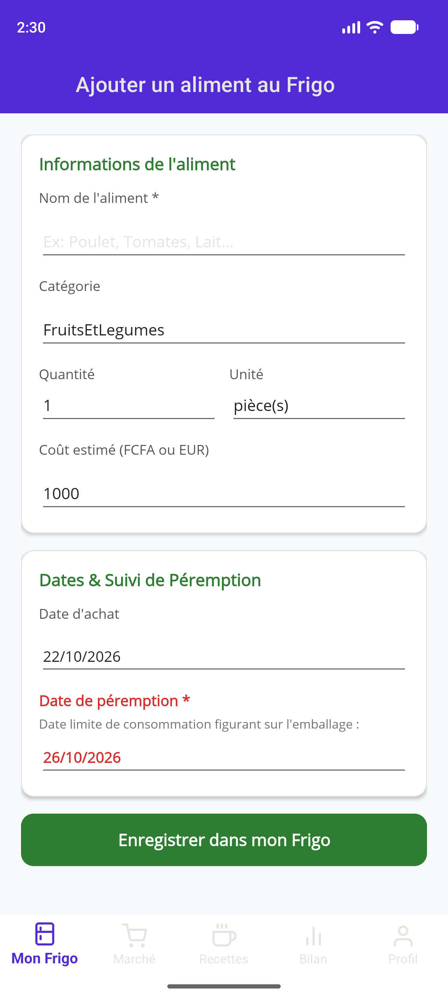

#### Composants XAML & Implémentation MVVM :
- **Fichier Source :** `Views/AddEditFoodPage.xaml` et `ViewModels/AddEditFoodViewModel.cs`
- **Contrôles utilisés :** `Picker` avec liaison sur l'énumération `FoodCategory`, champs `Entry`, sélecteurs `DatePicker` pour la date d'achat et la date de péremption, bouton d'enregistrement avec commande asynchrone `SaveFoodCommand`.

---

### Interface 6 : Checklist Interactive de Marché (`ShoppingListPage`)

#### Rôle & Spécifications Fonctionnelles :
- Préparation méthodique des courses pour éviter les achats compulsifs ou redondants.
- Formulaire supérieur rapide : saisie de l'article, catégorie, quantité et prix unitaire prévisionnel.
- Liste sous forme de **checklist interactive** avec cases à cocher (`CheckBox`).
- Bouton de suppression rapide par élément (icône poubelle).
- **Déclenchement du transfert :** Dès que l'utilisateur coche la case d'un article acheté, l'application déclenche automatiquement l'ouverture de la modale de transfert vers le frigo.

  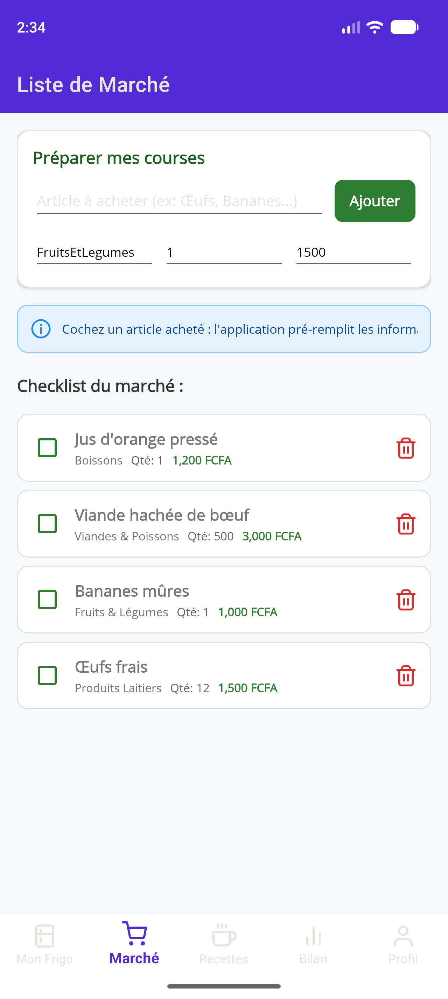

#### Composants XAML & Implémentation MVVM :
- **Fichier Source :** `Views/ShoppingListPage.xaml` et `ViewModels/ShoppingListViewModel.cs`
- **Contrôles utilisés :** `Grid` de saisie compacte, `CollectionView` avec liaison sur `ObservableCollection<ShoppingItem>`, `CheckBox` connecté à `ItemCheckedCommand`.

---

### Interface 7 : Modale de Transfert Marché vers Frigo (`TransferConfirmModal`)

#### Rôle & Spécifications Fonctionnelles :
- Dialogue modal contextuel apparaissant en surimpression lors du cochage d'un article au marché.
- **Pré-remplissage intelligent :** Le nom de l'article, sa catégorie, sa quantité et la date d'achat (date du jour) sont automatiquement injectés sans nouvelle saisie requise.
- **Saisie de la date de péremption :** L'utilisateur ajuste simplement la date limite réelle constatée sur le paquet acheté via le calendrier interactif.
- Boutons d'action : « Annuler » pour décocher l'élément, ou « Valider l'ajout » pour transférer le produit dans l'inventaire du frigo et clôturer la ligne de course.

  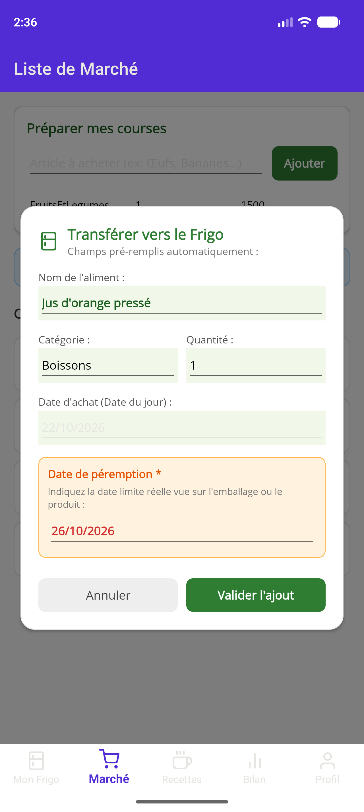

#### Composants XAML & Implémentation MVVM :
- **Fichier Source :** Intégrée dans `Views/ShoppingListPage.xaml` (Conteneur conditionnel avec fond semi-transparent `BackgroundColor="#80000000"`) et pilotée par `ShoppingListViewModel.cs`.
- **Contrôles utilisés :** Propriété `IsVisible="{Binding IsTransferModalVisible}"`, champs de confirmation en lecture seule, sélecteur `DatePicker`, boutons de validation et d'annulation.

---

### Interface 8 : Menus de la Semaine & Idées Recettes Anti-Gaspi (`RecipesPage`)

#### Rôle & Spécifications Fonctionnelles :
- Interface culinaire articulée autour d'un sélecteur bi-mode :
  1. **Idées Recettes Anti-Gaspi :** Algorithme analysant les aliments critiques du frigo et suggérant en priorité les plats permettant d'éviter leur gaspillage.
  2. **Menus Semaine :** Organisation des repas du lundi au dimanche (déjeuner et dîner).
- Badge indicateur de performance anti-gaspi : *« Sauve X ingrédient(s) du frigo »*.
- Mention du temps de préparation estimé et du nombre de portions.

  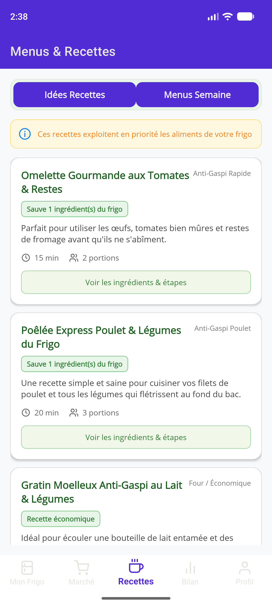

#### Composants XAML & Implémentation MVVM :
- **Fichier Source :** `Views/RecipesPage.xaml` et `ViewModels/RecipesViewModel.cs`
- **Contrôles utilisés :** Commutateur segmenté (`Button` stylisés modifiant la propriété `IsShowingWeeklyMenu`), `CollectionView` liée à `SuggestedRecipes`, cartes avec tags et labels textuels.

---

### Interface 9 : Fiche Complète d'une Recette (`RecipeDetailPage`)

#### Rôle & Spécifications Fonctionnelles :
- Fiche de préparation détaillée d'une recette sélectionnée.
- Liste récapitulative des ingrédients nécessaires avec distinction de ceux déjà présents dans le réfrigérateur.
- Guide de préparation séquentiel pas-à-pas numéroté pour faciliter la réalisation en cuisine.
- Bouton d'action final : **« J'ai préparé ce plat (Sauver les aliments) »** permettant de décompter automatiquement les aliments utilisés et d'enregistrer l'impact anti-gaspillage.

  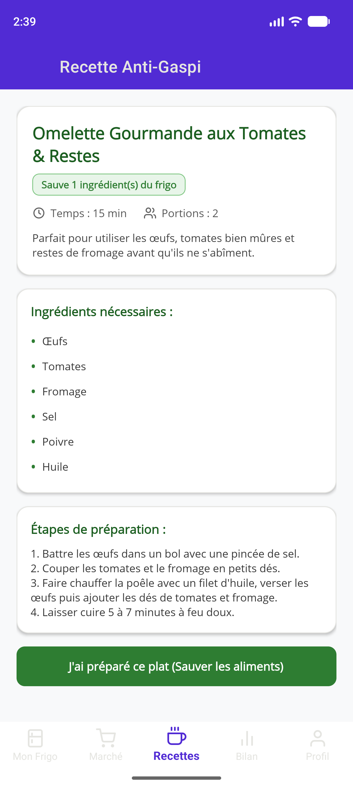

#### Composants XAML & Implémentation MVVM :
- **Fichier Source :** `Views/RecipeDetailPage.xaml` et `ViewModels/RecipeDetailViewModel.cs`
- **Contrôles utilisés :** Réception de la recette via `QueryProperty`, `ScrollView` pour la lecture sur petits écrans, listes ordonnées et bouton de validation relié à `CookRecipeCommand`.

---

### Interface 10 : Bilan Anti-Gaspi & Analytics Financiers (`WasteStatsPage`)

#### Rôle & Spécifications Fonctionnelles :
- Tableau de bord analytique mesurant l'efficacité environnementale et financière du foyer.
- Calcul en direct du ratio d'aliments sauvés :
  $$\text{Taux de sauvetage} = \frac{\text{Aliments Consommés}}{\text{Aliments Consommés} + \text{Aliments Jetés}} \times 100$$
- Attribution d'un statut citoyen évolutif (*Éco-Citoyen Débutant*, *Intermédiaire*, *Maître Zéro Gaspillage*).
- **Indicateurs financiers en FCFA :**
  - Carte verte : Montant total des économies réalisées (valeur des aliments consommés à temps).
  - Carte rouge : Coût financier des aliments gaspillés et jetés.
- Liste chronologique des dernières actions enregistrées avec horodatage.

  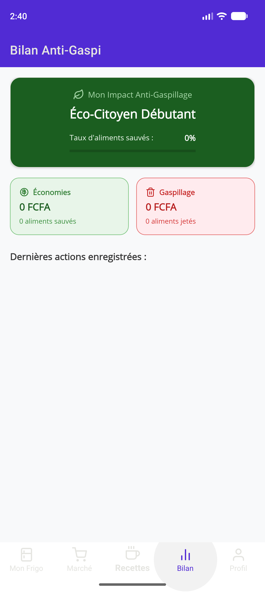

#### Composants XAML & Implémentation MVVM :
- **Fichier Source :** `Views/WasteStatsPage.xaml` et `ViewModels/WasteStatsViewModel.cs`
- **Contrôles utilisés :** Conteneur `Frame` vert avec barre de progression `ProgressBar`, grille à 2 colonnes pour les indicateurs financiers, `CollectionView` pour le journal d'activité.

---

### Interface 11 : Profil Utilisateur & Paramètres (`ProfileSettingsPage`)

#### Rôle & Spécifications Fonctionnelles :
- Encart identitaire de l'étudiante (Diom Lucraine Lethicia Fien, Master 2 Génie Logiciel).
- **Configuration des notifications préventives :** Réglage du délai d'alerte avant péremption via un curseur `Slider` (de 1 à 7 jours).
- Ajustement de la taille du foyer pour le recalibrage automatique des recettes.
- Bouton de **réinitialisation des données de démonstration** permettant de recharger l'inventaire type pour les présentations orales.
- Bouton de **déconnexion** avec retour sécurisé vers l'écran de bienvenue.

  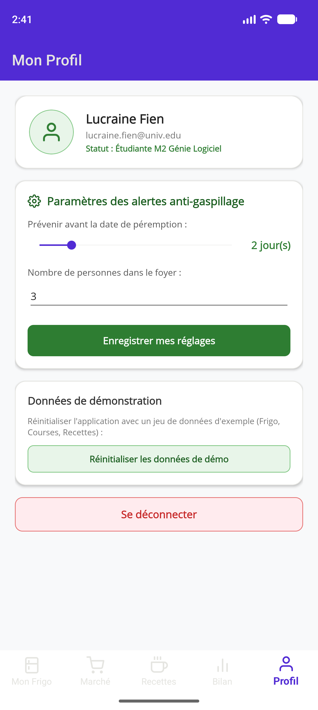

#### Composants XAML & Implémentation MVVM :
- **Fichier Source :** `Views/ProfileSettingsPage.xaml` et `ViewModels/ProfileSettingsViewModel.cs`
- **Contrôles utilisés :** `Slider` avec liaison bidirectionnelle, `Entry` numérique, `Button` stylisés avec bordures et teintes distinctives, commandes `SaveSettingsCommand`, `ResetDemoDataCommand` et `LogoutCommand`.

---

## 4. Guide d'Exportation du Dossier au Format PDF

Pour générer un document PDF prêt à être imprimé ou téléversé sur la plateforme universitaire :

### Méthode 1 : Export direct via Visual Studio Code (Recommandée)
1. Installez l'extension **Markdown PDF** (ou **Markdown Preview Enhanced**) dans Visual Studio Code.
2. Ouvrez le fichier `DOSSIER_SCREENSHOTS_SIMULATION.md`.
3. Faites un clic droit n'importe où dans l'éditeur et sélectionnez : **Markdown PDF: Export (pdf)**.
4. Le fichier PDF est automatiquement généré dans le même répertoire avec toutes les images réelles intégrées et mises en page.

### Méthode 2 : Impression PDF via un navigateur Web (Microsoft Edge ou Google Chrome)
1. Ouvrez l'aperçu Markdown dans VS Code (`Ctrl + Shift + V`).
2. Faites un clic droit sur l'aperçu $\rightarrow$ **Ouvrir dans le navigateur**.
3. Dans le navigateur, appuyez sur **`Ctrl + P`**.
4. Sélectionnez la destination **Enregistrer au format PDF**, cochez l'option **Graphiques d'arrière-plan**, et validez.

---
*Dossier technique réalisé dans le cadre de l'UE Atelier de Développement Mobile — Master 2 Génie Logiciel.*
